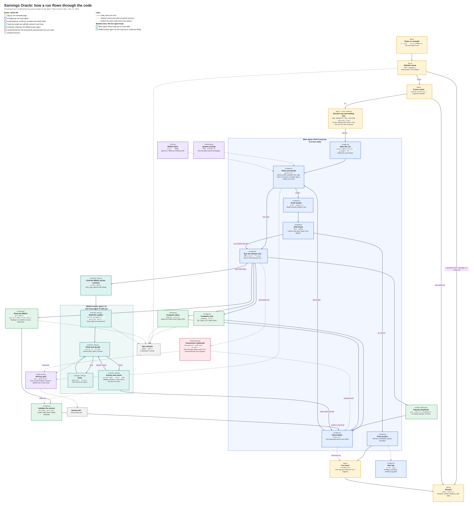

# Earnings Oracle

IS883 term project, Boston University, Fall 2026 · Team 6: German Cifuentes, Javier Berain Garza, Nicolas Rios Cabo, Vicente Llinares Llata

**App:** https://earnings-oracle.streamlit.app/ · **Project board:** https://github.com/users/Vicen-75/projects/1/views/1

Earnings Oracle is for a junior financial analyst who is building a stock pitch and wants a quick, sourced read on where a company's earnings are heading. You type a US ticker. An AI agent reads the company's last two 10-Ks on SEC EDGAR, chooses which financial ratios matter for that industry, reads the MD&A, and predicts whether **operating income** (pre-tax income for banks and insurers) will **increase or decrease** next fiscal year. It shows a probability, the signals behind the call, passages quoted from the filings and a ratio table. If the data is not there (unknown ticker, a 20-F filer, no MD&A) it says "no data found" instead of guessing.

The output is generated by a language model and can be wrong. It is not financial advice.

## How it works



The diagram is generated from `src/flowchart.py`, the same model drawn in the app's **How it works** tab, so it names real files and functions.

1. **Before any model call**, `app.py` checks the ticker on EDGAR, serves a cached run if the ticker was analyzed in the last 6 hours, and enforces a cap of 10 new analyses per visitor. A waiting line (`src/run_limiter.py`) lets only a few analyses run at once across all visitors.
2. **The main agent** (`src/agent.py`, prompt `TOOL_SYSTEM_V5`, Gemini 3.1 Flash-Lite) runs a ReAct loop with up to 9 tool calls. The model decides which tools to call and in what order.
   - `get_company_card` gives industry (SIC), fiscal year end, filings and the target metric
   - `get_industry_playbook` gives the ratios that matter for that industry (14 groups, 24 ratios)
   - `compute_ratios` computes the ratios the model picked, from XBRL data
   - `get_mdna` extracts and validates the MD&A section
   - `locate_mdna` is a second agent that finds the MD&A through the filing's table of contents when the parser fails
3. **Self-check.** The first answer is treated as a draft. The code asks once whether a ratio could test a claim in the MD&A, and the model either computes it or confirms.
4. **Results.** The app shows the direction, probability, cited passages, the industry playbook and the ratio table, with a live trace of every step.

Every model call goes through `src/key_pool.py`, which spreads analyses across several API keys and moves a run to another key when it hits a rate limit. An optional anonymizer (`src/anonymize.py`) replaces the company name, ticker, CIK and brand names with "the Company" in every tool result. It is used in anonymized test runs and is off in the app.

## Results

Pre-registered backtest on **200 randomly drawn US companies** (prompt V5, run Nov 5 to 6, named runs). Design, sampling and analysis were fixed before any run in [`docs/test_plan.md`](docs/test_plan.md). The model predicted the target year using only the filings before it, and every company passed the contamination test first.

| Predictor | Correct | Accuracy (95% interval) |
|---|---|---|
| **Earnings Oracle** | 121 of 200 | **60%** (54% to 67%) |
| Always increase | 126 of 200 | 63% (56% to 69%) |
| Momentum (last year's direction) | 104 of 200 | 52% (45% to 59%) |
| Reverse momentum | 96 of 200 | 48% (41% to 55%) |

- The model **beats momentum and reverse momentum** (exact McNemar test, p = 0.036 and 0.043) but shows **no clear difference from always increase** (p = 0.58). By the bar we set in advance, it does not yet beat all three baselines.
- **Citations are real.** 557 of 561 quoted passages (99%) are verbatim or near-verbatim text from the filings the model read, and none come from the hidden target-year filing.
- **Main failure.** The model tends to carry last year's direction forward. 56 of its 75 answered misses are reversals it did not see coming. When it breaks from the trend it is right 67% of the time.
- **Cost and speed.** About $0.03 and 50 seconds per analysis at paid-tier prices (the class app runs on the free tier).
- **Not yet measured.** The success metric is anonymized accuracy and the anonymizer is built, but the 200-company run has not been repeated anonymized. A check on the 20 development companies found the anonymized text leak-free for 19 of 20, yet the model could still name the company for 17 of 20.

Full reports: [backtest](eval/backtest_200_report.md) · [error analysis](eval/error_analysis_200.md) · [citation check](eval/citation_check_report.md) · [cost](eval/cost_report.md) · [load test](eval/load_test_report.md) · [contamination test](docs/contamination.md)

## Run it locally

```bash
pip install -r requirements.txt
mkdir -p .streamlit
echo 'GEMINI_API_KEY = "your-key"' > .streamlit/secrets.toml
streamlit run app.py
```

Optional secrets are `GEMINI_API_KEYS` (comma-separated list for the key pool), `MAX_CONCURRENT_RUNS` and `TEAM_PASSCODE` (unlocks the Tests tab). From the command line, `python -m src.agent CAT` runs one analysis and `python -m eval.run_backtest` runs a backtest.

## Repository

| Path | What is there |
|---|---|
| `app.py` | Streamlit app with three tabs (Analyze, Tests, How it works) |
| `src/` | Agent, tools, prompts, EDGAR access, MD&A parser and locator, ratios, anonymizer, baselines, key pool, waiting line |
| `eval/` | Test sets, backtest, contamination, citation, anonymizer, cost and load scripts, with their results and reports |
| `docs/` | Proposal and feedback, success metric, test plan, tool-calling design, ratio directory, contamination test, architecture diagram |

The workshop checkpoint submitted on Oct 22 is archived in [`docs/workshop_checkpoint.md`](docs/workshop_checkpoint.md).

## Data sources

- **SEC EDGAR** (public): ticker to CIK, submissions API, XBRL company facts and the 10-K documents. Requests carry the required User-Agent and are limited to 8 per second and cached.
- **Gemini API** (`gemini-3.1-flash-lite`) for every model call.
- No data about real, identifiable people.
