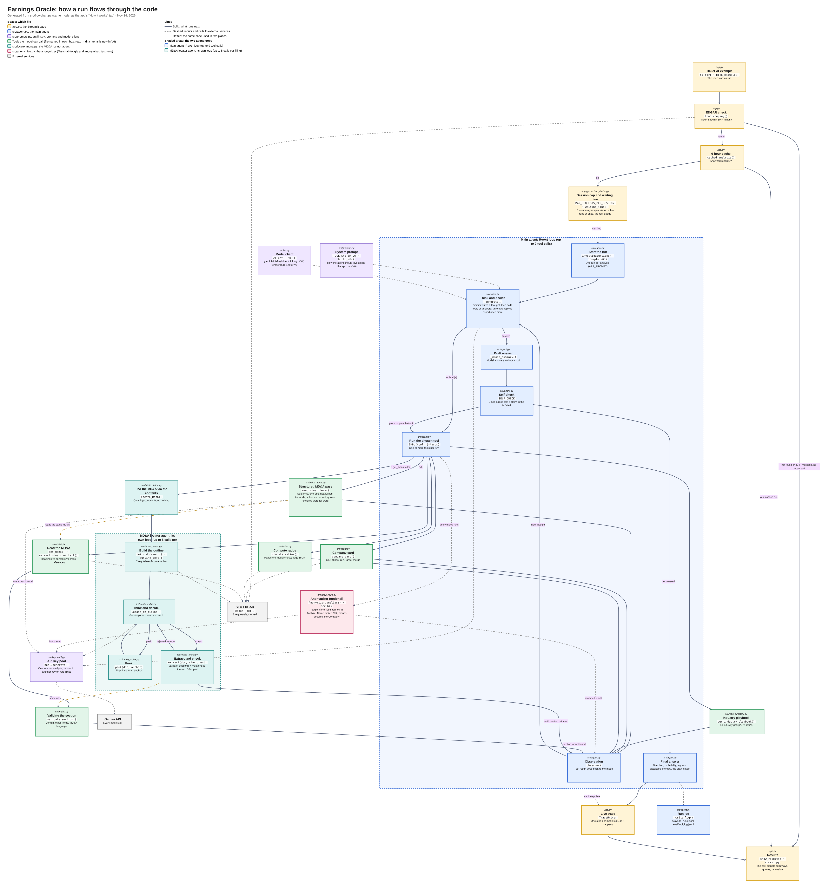

# Earnings Oracle

IS883 term project, Boston University, Fall 2026 · Team 6: German Cifuentes, Javier Berain Garza, Nicolas Rios Cabo, Vicente Llinares Llata

**App:** https://earnings-oracle.streamlit.app/ · **Project board:** https://github.com/users/Vicen-75/projects/1/views/1

Earnings Oracle is for a junior financial analyst who is building a stock pitch and wants a quick, sourced read on where a company's earnings are heading. You type a US ticker. An AI agent reads the company's last two 10-Ks on SEC EDGAR, chooses which financial ratios matter for that industry, reads the MD&A, and predicts whether **operating income** (pre-tax income for banks and insurers) will **increase or decrease** next fiscal year. It shows a probability, the signals behind the call, passages quoted from the filings and a ratio table. If the data is not there (unknown ticker, a 20-F filer, no MD&A) it says "no data found" instead of guessing.

The output is generated by a language model and can be wrong. It is not financial advice.

## How it works



The diagram is generated from `src/flowchart.py`, the same model drawn in the app's **How it works** tab, so it names real files and functions.

1. **Before any model call**, `app.py` checks the ticker on EDGAR, serves a cached run if the ticker was analyzed in the last 6 hours, and enforces a cap of 10 new analyses per visitor. A waiting line (`src/run_limiter.py`) lets only a few analyses run at once across all visitors.
2. **The main agent** (`src/agent.py`) runs prompt **V6** once per analysis (`APP_PROMPT` in `app.py`) on Gemini 3.1 Flash-Lite, temperature 1.0, thinking LOW. It is a ReAct loop with up to 9 tool calls, and the model decides which tools to call and in what order.
   - `get_company_card` gives industry (SIC), fiscal year end, filings and the target metric
   - `get_industry_playbook` gives the ratios that matter for that industry (14 groups, 24 ratios)
   - `compute_ratios` computes the ratios the model picked, from XBRL data
   - `get_mdna` extracts and validates the MD&A section
   - `read_mdna_items` (new in V6, `src/mdna_items.py`) is one structured pass over the MD&A with schema-checked output. It lists guidance, last year's one-off gains and charges, headwinds, tailwinds and segment trends, each with a quote checked word for word against the filing
   - `locate_mdna` is a second agent that finds the MD&A through the filing's table of contents when the parser fails
3. **Self-check.** The first answer is treated as a draft (`draft_answer` in the trace). The code asks once whether a ratio could test a claim in the MD&A, and the model either computes it or confirms. If the final answer comes back empty, the app keeps the draft.
4. **Results.** The app shows the call (direction, probability and the momentum baseline), the signals both ways, the quoted passages and the ratio table, with a live trace of every step.

Every model call goes through `src/key_pool.py`, which spreads analyses across several API keys and moves a run to another key when it hits a rate limit. The anonymizer (`src/anonymize.py`) replaces the company name, ticker, CIK and brand names with "the Company" in every tool result. It is a toggle in the Tests tab and is off in the Analyze tab.

## Results

All tests were pre-registered in [`docs/test_plan.md`](docs/test_plan.md): the companies, the truth rule and the analysis were fixed before any run. The model predicts the target year using only the filings before it. "Beats the baselines" means significantly better than all three (exact McNemar test, p < 0.05). A missing answer counts as wrong.

**The final test: V6, the version the app runs, on 400 fresh companies (set D, one look).**

| Predictor | Correct | Accuracy | V6 against it (p) |
|---|---|---|---|
| **Earnings Oracle, V6** | 245 of 400 | **61%** | |
| Always increase | 254 of 400 | 64% | 0.49, no clear difference |
| Momentum (last year's direction) | 229 of 400 | 57% | 0.20, no clear difference |
| Reverse momentum | 171 of 400 | 43% | < 0.0001, V6 better |

- **By the bar we set in advance, the model does not beat all three baselines.** It clearly beats reverse momentum but not always increase or momentum.
- **Across the 800 companies V6 was not tuned on** (sets B, C and D, descriptive), V6 is right on 64.0% against 62.2% for always increase. That is 1.8 points, with an interval of about -2.4 to +5.9. It is clearly above momentum (p = 0.0003) and reverse momentum.
- **It reads rather than remembers, as far as we can test (#41).** On set A (200 companies, prompt V5) the model is right on 121 named and **118 anonymized** (p = 0.66, no clear difference). The caveat is that the model still identifies 169 of 199 companies from the anonymized MD&A, so anonymizing hides the name more than the identity. On the 30 it cannot identify, named and anonymized score 20 and 19.
- **The prompt change did not move accuracy.** V5 and V6 score 134 and 135 of 200 on set B, and no single part of V6 mattered in the ablation (all p > 0.6). The app runs V6 because it is cheaper, faster and its MD&A pass is structured.
- **Citations are real.** On set A (V5), 557 of 561 quoted passages (99%) are verbatim or near-verbatim text from the filings the model read, and none come from the hidden target-year filing.
- **Main failure.** The model tends to carry last year's direction forward, and most misses are reversals it did not see coming. V6 catches twice as many good years turning bad as V5 (22 against 11 on set A, in-sample).
- **Cost and speed.** V6 with one run costs about **$0.024** per analysis (median 34 seconds) at paid-tier prices, against $0.031 and 44 seconds for V5. The class app runs on the free tier.

Full reports: [set D](eval/set_d_report.md) · [set B](eval/set_b_stage2_report.md) · [set A, named](eval/backtest_200_report.md) · [set A, anonymized](eval/backtest_200_anon_report.md) · [named vs anonymized](eval/named_vs_anon_report.md) · [error analysis V6](eval/error_analysis_v6.md) · [citation check](eval/citation_check_report.md) · [cost](eval/cost_report.md) · [load test](eval/load_test_report.md) · [success metric](docs/success_metric.md)

## Run it locally

```bash
pip install -r requirements.txt
mkdir -p .streamlit
echo 'GEMINI_API_KEY = "your-key"' > .streamlit/secrets.toml
streamlit run app.py
```

Optional secrets are `GEMINI_API_KEYS` (comma-separated list for the key pool), `MAX_CONCURRENT_RUNS` and `TEAM_PASSCODE` (unlocks the Tests tab). From the command line, `python -m src.agent CAT` runs one analysis and `python -m eval.run_backtest` runs a backtest (`--prompt V6`, `--anonymize`, `--set b`). The command-line tools default to V5, so the committed results can be rerun as they were.

## Repository

| Path | What is there |
|---|---|
| `app.py` | Streamlit app with three tabs (Analyze, Tests, How it works) |
| `src/` | Agent, tools, prompts, EDGAR access, MD&A parser, locator and structured pass, ratios, anonymizer, baselines, key pool, waiting line, look of the Analyze tab (`ui.py`) |
| `eval/` | Test sets A to D, backtests, ablations, contamination, citation, anonymizer, cost and load scripts, with their results and reports |
| `docs/` | Proposal and feedback, success metric, test plan, tool-calling design, ratio directory, contamination test, architecture diagram |

The workshop checkpoint submitted on Oct 22 is archived in [`docs/workshop_checkpoint.md`](docs/workshop_checkpoint.md).

## Data sources

- **SEC EDGAR** (public): ticker to CIK, submissions API, XBRL company facts and the 10-K documents. Requests carry the required User-Agent and are limited to 8 per second and cached.
- **Gemini API** (`gemini-3.1-flash-lite`) for every model call.
- No data about real, identifiable people.
